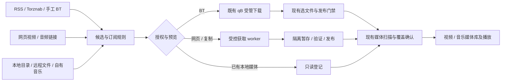

# NAS 多来源资源收集修改计划

规划日期：2026-11-19；实施授权：2026-11-20。状态：按用户“按计划实现”指令实施中。用户已确认首期覆盖多种来源；以下分期是开发顺序，P0–P6 全部完成才构成首期交付。API落地字段以 api-contract.md 为准，完成情况以验证记录为准。

## 1. 产品流程与职责

“资源收集”负责发现、决策、任务历史和入库协调；下载器负责传输，执行端负责网页保存和受控复制，媒体库负责索引与播放。新模块不新增媒体类型，不替换已有下载中心。

| 首期入口 | 获取方式 | 产品行为 |
| --- | --- | --- |
| 影视与动漫 RSS | 新增 RSS 订阅，复用 qB | 规则试运行→候选→人工确认或已授权的确定性自动规则→选文件→发布入库 |
| 手工搜种/磁力/种子 | 复用 Torznab/qB | 原功能继续可用，补充来源、收集任务和入库结果关联 |
| 网页视频、提取音频 | 固定 yt-dlp 适配器 | 单链接单条目、格式预览、受控后处理、输出清单；批量条目独立记录 |
| 本地影音、自有音乐 | 已授权目录登记或归档复制 | 默认只读登记现有文件；需要副本时预览并复制，不改写原标签 |
| 自有远程文件与音乐 | 固定 rclone copy 适配器 | 从预配置 remote 选择路径→预览→复制→验证→入库，源文件保留 |
| 外部 MoviePilot/AutoBangumi/Servarr/MeTube | 登记外部应用入口与独立完成目录 | 外部工具自行订阅/获取；本系统导入成品，不接管其 qB 任务 |

音乐首期覆盖获取已有音源与入库播放，beets 只保留后续对整理副本增强的接口。无需先部署额外播放器。

## 2. 必须保留与修订的现有边界

仓库事实和准确代码依据见 [repository-collection.md](research/repository-collection.md)，外部工具依据见 [source-integrations.md](research/source-integrations.md)。

- 保留既有 BT 身份去重、受管归属、添加意图、选文件版本和发布门禁，不以 qB 100% 作为入库依据。
- 现有内存搜索结果不能充当持久订阅记录；新增候选库保存稳定来源引用，私密载荷由后端重新解析。
- 新增收集协调器，不把长时间网络/复制操作塞进只有 scan/enrich 分支的现有 jobs worker。
- 本地媒体默认只读，收集暂存和已发布产物通过独立目录和门禁管理；不允许整理工具直接改写已有媒体。
- 现有 engine helper 继续只管固定 qB/Jackett 引擎；另建 collection worker，避免变成任意工具执行入口。
- 当前启动配置只读；新增来源 CRUD 不伪装成对原 `/api/settings` 的任意写入，也不覆盖已有文件配置来源。
- 开发 P0 必须先更新或补充 collection contract，明确 RSS、自动选文件、schema 和发布规则；现有手工搜索契约仍保持手工语义。
- 主库当前为 v2，下一迁移号在实际实施时按主分支分配，与插件计划协调，禁止两个任务各自覆盖同一版本。

## 3. 数据与状态设计

表名和字段为建议，实施时按最小职责收敛；迁移仅增加必要表、索引与关联。

| 建议实体 | 关键字段及中文含义 |
| --- | --- |
| `collection_sources` | `id` 来源标识；`kind` 来源类型；`name` 名称；`enabled` 是否收取；`revision` 配置版本；`config` 不含秘密的类型化配置；`secret_ref` 凭据引用；`origin` 手工/启动配置/托管来源归属 |
| `collection_subscriptions` | `source_id` 来源；`content_type` 内容类别；`rule` 匹配与排除规则；`mode` 待确认/明确启用的自动模式；`selection_policy` 确定性文件选择策略；`target_library_id` 目标库；`next_run_at` 下次执行；`rule_revision` 规则版本 |
| `collection_candidates` | `source_id + external_id` 来源稳定身份；`identity_strength` 身份可信程度；`media_key` 已确定的作品/集数身份；`payload_ref` 私密载荷后端引用；`decision` 命中/待确认/忽略；`reason` 中文决策说明 |
| `collection_runs` | `source_id/subscription_id` 调度对象；`cursor` 有界游标；`etag/last_modified` 条件收取信息；`status` 执行状态；`next_retry_at` 退避时间；`counts` 收取和命中数 |
| `collection_tasks` | `request_id` 幂等请求；`revision` 乐观版本；`executor_kind` 执行类型；`executor_id/operation_id` 执行端与外部操作；`download_id` 既有 BT 任务；`config_revision` 提交时配置版本；`state` 获取阶段；`import_state` 入库阶段；`error_code` 安全错误类别 |
| `collection_artifacts` | `task_id` 收集任务；`relative_path` 受控产物路径；`size/checksum/mtime` 完整性与版本证据；`publish_state` 发布状态；`item_id` 实际媒体条目；`ownership` 数据归属 |
| `collection_task_events` | `task_id` 任务；`attempt` 尝试次数；`stage` 阶段；`message` 脱敏中文事件；`created_at` 时间；`retention` 按策略清理 |

最小状态流：`pending_review → queued → dispatching → acquiring → verifying → publishing → importing → completed`；分支有 `failed/canceled/reconciliation_required`。`dispatching` 结果不确定时先对账，不能直接当作未提交。暂停、续传和取消按适配器能力显示，不编造所有来源统一百分比。

`external_id` 只保存经过审查的非敏感标识或不可逆摘要；带秘密的 GUID/URL/载荷归入私密引用，不能出现在公开 DTO、事件或普通主库备份。

本地只读登记可从校验直接进入 importing。BT 状态仍以既有 Download 为权威，收集任务保存关联和业务决策，避免第二套状态机反向覆盖下载状态。

去重分层：

1. 来源条目按 `source_id + external_id` 去重；弱 GUID 或规范化链接仅为来源线索。
2. BT 继续按完整算法身份去重；网页链接按提取后的 provider/内容标识与用户输出规格识别，不能仅比较原 URL。
3. 作品、季集和发行版本分开；标题相同不证明文件相同，跨来源身份不足时提示冲突。
4. 文件导入保存来源路径/版本和产出关系，内容摘要可复用实际工具的可靠证据；不只凭同名或大小删除/覆盖已有文件。
5. 显式重新获取以新意图记录，不通过删除历史绕过重复保护。

首次 RSS 启用先建立基线；历史回填另有预览和数量上限。默认只生成待确认候选。自动规则必须明确授权匹配条件、目标和文件选择；集数不明、季包、绝对集数未映射或匹配多个发行时转待确认。自动升级已有画质不在首期。

## 4. 执行端、目录和凭据

### 执行端协议

- 主服务持久保存业务意图；执行端持久保存实际操作、产物和取消结果，两者通过稳定 `operation_id` 幂等对账。
- 固定能力包括 `fetch_web_media`、`copy_remote_files` 和必要的 `copy_local_files`。协议返回能力、工具版本、健康、操作状态和产物清单。
- 启动时探测固定 yt-dlp/rclone、ffmpeg/ffprobe 及必要运行时；工具版本和镜像摘要纳入部署清单。无工具/无权限/无网络能力给出具体不可用原因。
- 使用类型化参数数组直接启动，不经 shell；不接受客户端传入可执行路径、任意参数、输出模板、rclone 配置或执行回调。关闭工具用户配置自动加载。
- 执行端使用独立状态目录、最小写权限和实例身份，不持有 Docker socket；远程连接使用经认证的 TLS 和实例级凭据，不向公网提供无认证任务端点。
- 对私密来源只授予该作业需要的凭据。普通 GET、事件、日志和错误不能回显密钥、签名链接或工具参数里的秘密。

### 目录与发布

建议独立角色：`worker-state/` 保存执行记录，`collection-data/staging/<operation>/` 暂存，`collection-data/complete/<operation>/` 保存已封存产物，`collection-secrets/` 保存限制权限的秘密引用。

执行端写 staging，工具退出及后处理完成后生成受控产物清单；校验常规文件、边界、类型、实际大小、已知摘要和文件版本，再在同卷内原子改名进入 complete。跨卷复制必须先复制到目标卷暂存并验证，再改名，不能让半成品出现在可扫描位置。清单不接受客户端自报绝对路径。

主服务审查计划和产物清单，并通过自身只读映射复核真实文件后才提交发布登记；worker 的“完成”回执不能自行授予媒体读取权限。主服务只读访问完成区；扫描、封面、直接读取、流播放都应用 collection 发布门禁，不能只隐藏列表。执行端不能继续覆盖已封存产物；后续变动使门禁冻结并记录异常。BT 数据继续走原 download gate，不复用或挪用 qB 目录。

已有本地只读登记使用受信目录和现有扫描契约，无需把所有文件再复制一遍。外部自动化来源只有明确完成标记/清单/可信事件或管理员选定的最终成品才能导入；短时大小稳定本身不证明完整。

可选硬链接仅在同卷、源不可再改且归属清楚时开放；qB 做种文件不得被重命名或改写。默认归档复制更容易理解。冲突采用跳过/保留独立副本/人工处理，首期不静默覆盖。

### 网络、配额和清理

- RSS 和预览有请求超时、响应大小、XML 条目/深度及重定向限制，拒绝危险 XML 解析方式。
- 公共网页获取的出站策略应覆盖 DNS、重定向和媒体子请求；不能仅校验初始链接。P0 验证执行环境可强制阻断本地、保留和元数据网络，否则只开放已审查的受限来源能力。
- 私网 qB、索引器和远程存储分别以显式来源策略允许，避免一条全局私网豁免。
- 并发、排队、单任务/批量大小、磁盘余量、超时、重试、日志与暂存保留均可配置，每个参数提供中文说明与默认值依据。
- 凭据与主库备份分离；恢复后未完成操作先对账。清理只作用于本实例拥有、未被使用且符合保留策略的暂存；移除来源不自动取消已有任务或删除产物。

## 5. 页面与 API 修改

桌面导航增加“资源收集”，手机从“更多”进入。收集中心建议使用五个分区：概览、来源、订阅、候选、任务。现有下载中心保留 BT 专用选文件和传输详情，收集中心通过任务链接跳转。

来源编辑显示类型、能力、最近成功时间、连接错误和凭据状态；连接测试不触发抓取历史或下载。新建规则先试运行，展示命中原因、目标位置、预算和是否会自动获取。任务详情展示获取、验证、发布、扫描各阶段，并只提供适配器实际支持的动作。

建议端点：

| 接口 | 用途 |
| --- | --- |
| `GET /api/collection/capabilities` | 执行端、来源和当前平台真实能力 |
| `GET/POST /api/collection/sources`、`PATCH /{id}` | 来源查询/创建/编辑/停用，变更带 revision |
| `POST /api/collection/sources/{id}/test`、`/refresh` | 分离只读连接测试与明确收取动作 |
| `GET/POST /api/collection/subscriptions`、`PATCH /{id}` | 规则查询、建立、修订、启停 |
| `POST /api/collection/subscriptions/{id}/preview`、`/run` | 无副作用试运行与有界补查 |
| `GET /api/collection/candidates`、`POST /{id}/acquire`、`/ignore` | 候选分页、确认获取和忽略 |
| `POST /api/collection/previews` | 网页/本地/远程条目预览，返回有时效的服务器预览标识 |
| `POST /api/collection/tasks` | 由候选/有效预览创建任务，使用 requestId 幂等 |
| `GET /api/collection/tasks`、`GET /{id}`、`GET /{id}/events` | 脱敏任务历史、详情与分页事件 |
| `POST /api/collection/tasks/{id}/actions` | 类型化 cancel/retry/retry_import，校验版本、归属和能力 |

端点省略部分路径的写法仅用于表格，实际均在 `/api/collection` 下。沿用会话认证、同源变更检查、严格 JSON 和显式 TypeScript/Go DTO，不把外部链接/密钥交给浏览器直接调用。现有媒体 ContentType 仍为五类。

## 6. 文件修改清单

以下是建议文件，新增文件按最终职责命名，不要求机械创建全部文件。

| 层次 | 现有文件/新增文件 | 修改目的 |
| --- | --- | --- |
| 路由/生命周期 | `internal/app/server.go`、`config.go`、`store.go` | 注册接口、启动/停止协调器、配置解释、顺序迁移 |
| 收集控制面（新增） | `collection_models.go`、`collection_store.go`、`collection_api.go`、`collection_runtime.go` | 类型、持久化、幂等任务、来源 CRUD、调度恢复 |
| 来源/规则（新增） | `collection_rss.go`、`collection_rules.go`、`collection_bt.go`、`collection_import.go` | 条目/规则、受控 BT 桥接、只读登记及入库协调 |
| 原链路复用 | `torrent_search*.go`、`downloads.go`、`download_sync.go`、`download_import.go`、`download_gate.go`、`jobs.go`、`libraries.go`、`music.go` | 仅提取必要服务与共享门禁，保留原手工语义；避免整体重写 |
| 执行协议/执行端（新增） | `internal/collectioncontract/`、`internal/collectionworker/`、`cmd/nas-collection-worker/` | 固定工具、持久操作、产物证明、进程树回收 |
| 前端 | `web/src/App.vue`、`types.ts`、`api.ts`、`DownloadCenter.vue`；新增 `CollectionCenter.vue`、来源/订阅/预览弹窗和 `collection.ts` | 新入口、类型化 API、状态、复用下载选择与媒体跳转 |
| Linux/NAS 部署 | `compose.yaml`、`compose.engines.yaml`、新增 collection overlay/profile 与 `Dockerfile.collection-worker` | 最小写卷、健康、镜像架构、工具和网络策略 |
| Windows Docker | `compose.desktop.yaml`、`internal/desktop/config.go`、`docker_compose.go`、`docker.go` 及发布打包脚本 | 同步精确模板、环境/卷角色、实际容器归属、镜像清单与完整停止 |
| 文档/验证 | `docs/api.md`、`docs/verification.md`、README、相关 `.trellis/spec/`；新增 `docs/collection.md`、`scripts/verify_collection.py` | 用户说明、执行契约、可复用集成验证与平台支持矩阵 |

## 7. 平台交付范围

| 平台 | 首期目标 | 验收限制 |
| --- | --- | --- |
| Linux / NAS 容器 | 主服务 + 受控 worker，所有首期来源入口 | 对目标 CPU 架构、UID/ACL、工具、卷、网络和真实媒体验证 |
| Windows 原生 | 内建 RSS/BT、只读本地登记，网页/远程复制通过已配对 worker | 远端完成区必须有主机可读映射；不能把远端绝对路径当成本地路径；未连接时标明缺失能力 |
| Windows Docker 完整模式 | 同一明确 profile 内加入受控 worker | 必须同步模板和真实资源校验、打包/健康/完整停止；不能只增加 Compose 服务或放宽数量 |
| Windows 原生本地工具 | 后续可选增强 | 若要宣称支持，另交付正确架构工具与进程树/文件释放验收；不作为首期必需路径 |
| 飞牛原生 FPK | 沿原插件/兼容任务独立推进 | Docker 运行成功不等于原生 FPK 兼容 |

映射在启用前用任务专属小探针和随机 nonce 验证“执行端写入区→主服务只读区”确为相同物理内容，再清理探针；不能仅比较路径字符串，也不能写入用户原媒体来测试。Windows 本地目录若未对远程 worker 开放，只读登记仍可用，归档复制则准确提示需补足映射。

远程 worker 是共享外部服务时，主程序退出仅关闭本实例连接和协调器，不停止整个远端服务；明确取消单个已拥有操作。整包托管 worker 随完整停止流程结束子进程并持久保存结果，不按进程名结束外部工具。

## 8. 开发顺序、依赖与阶段出口

| 阶段 | 修改内容 | 阶段出口 |
| --- | --- | --- |
| P0 契约和样例验证 | 明确源身份、选文件授权、目录、平台、网络、凭据；在目标执行端验证网页视频/音频和远程复制样例 | 合同修订方案和能力矩阵确定；不把未知兼容性带入发布承诺 |
| P1 收集基础与执行协议 | 来源/候选/任务/产物表、增量迁移、幂等状态、能力 API、worker 协议/对账、入库门禁与 UI 骨架 | 空白升级和旧库升级均保留数据；重启/超时不重复提交；可用伪执行器联调 |
| P2 RSS 与 BT | 有界收取、基线/回填、规则试运行、待确认/受控自动、qB 复用 | RSS→选文件→媒体库；来源故障不影响原手工搜种，跨工具冲突不接管 |
| P3 网页音视频 | 固定 yt-dlp、格式/音频预览、受控后处理、批量条目及预算 | 一条视频与一条提取音频真实入库播放；缺工具、取消、失败和重试状态正确 |
| P4 本地/远程/音乐 | 本地只读登记/可选归档、rclone copy、路径预览、音乐读取、目标冲突 | 本地音乐、远程文件及远程音乐入库；源不删改、跨卷/重名/部分失败可恢复 |
| P5 统一操作与部署 | 完整收集中心、订阅/候选操作、事件与统计、目录映射、Linux/Windows profile、备份与退出 | 手机/桌面操作一致；声明平台能力真实，完整停止/重启和实际资源校验通过 |
| P6 整体验收与文档 | 跨来源去重/失败矩阵、原功能回归、使用/恢复说明、临时测试清理 | 全部首期入口与平台矩阵验收后发布，记录真实执行证据 |
| P7 后续生态 | MoviePilot/AutoBangumi/Servarr 固定版本状态/动作、beets 副本整理、插件分发 | 按独立需求和实例协议验证，不作为 P0–P6 阻塞 |

P0→P1 为共同前置；P2/P3/P4 共用 P1 的稳定协议；P5/P6 在三条来源链路完成后汇合。此顺序不改变“多来源一起做”的首版范围。用户于2026-11-20授权按此计划实施，当前按实际验证证据推进交付。

## 9. 验证、发布和回退

实施时构建/测试统一经 `python -B scripts/project_env.py -- ...`：Go vet/test/build、前端 typecheck/build、既有 verify.py 与新增集成验证。按变更增加有意义的幂等/恢复/边界用例；任务结束清理此次生成的临时单元测试，保留可复用集成脚本及既有测试。

关键验收矩阵包括：首次基线和历史回填、重复条目/哈希/导入、断网重试、外部调用结果不确定、进程重启、执行端离线、磁盘不足、路径越界/链接、跨卷、同名、下载完成但扫描失败、媒体库删除、备份恢复、来源停用、取消与完整退出。页面按项目规定宽度、主题、键盘和错误状态验收。

发布以能力开关启用新来源；关闭收取只停止新发现，不误删现有任务。保留原搜索/下载/播放路径和既有配置来源。迁移前备份主库和执行端状态/秘密引用，先验证恢复；已有新 schema 数据后不能简单回退旧二进制，需使用匹配版本或经过验证的备份恢复方案。worker 工具升级独立锁定与验证，不采用每次启动自动拉取最新版。

完整外部研究、源码行号和未实测限制见本任务 [research/](research/)，闭环/状态/目录/平台依据见 [pipeline-design.md](research/pipeline-design.md)；API落地字段以[实现契约](api-contract.md)为准，执行结果以验证记录为准。
